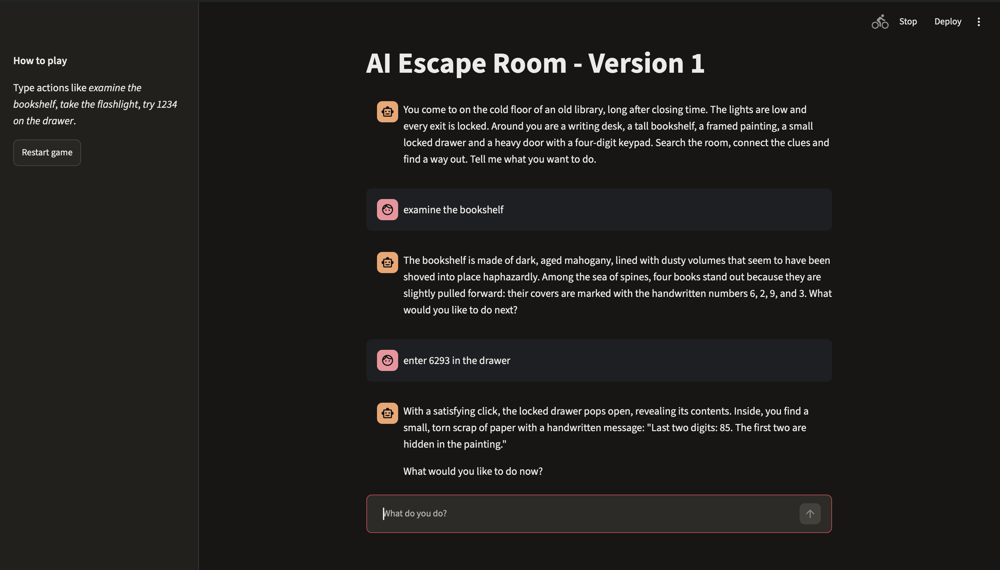
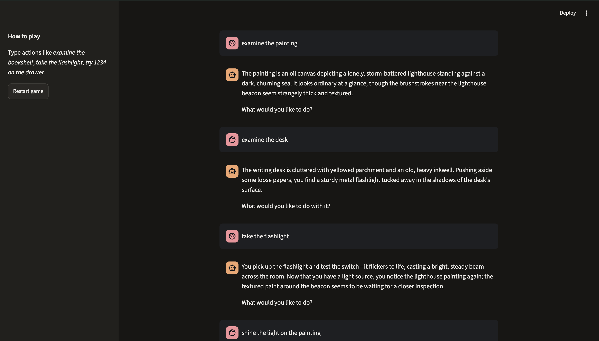
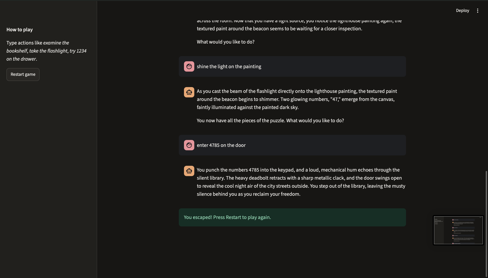
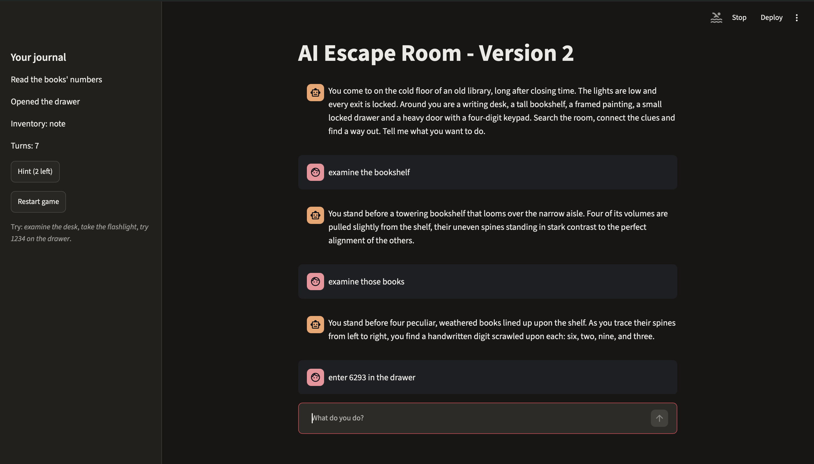
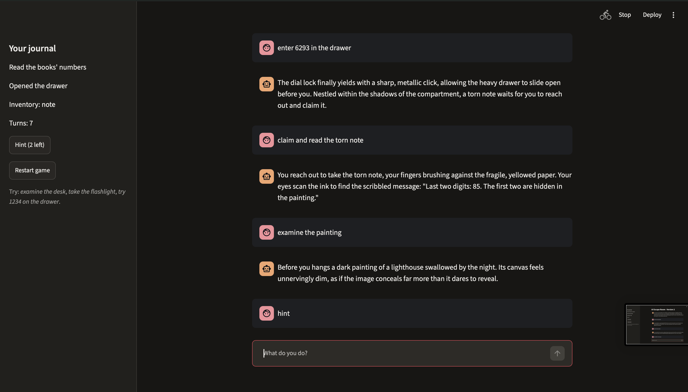
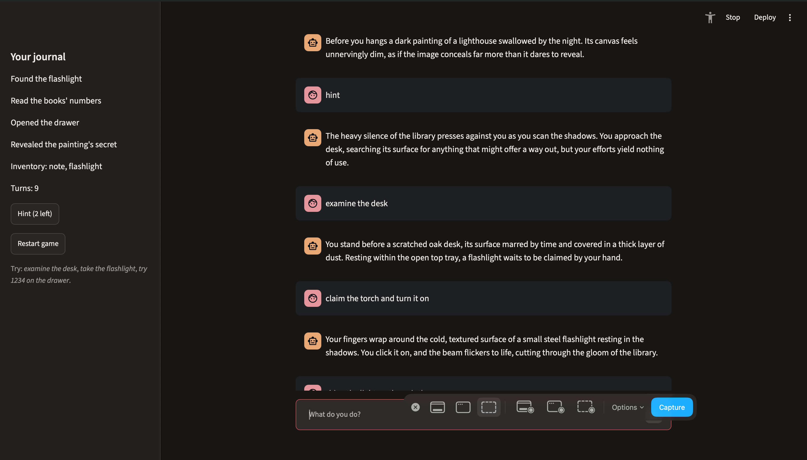
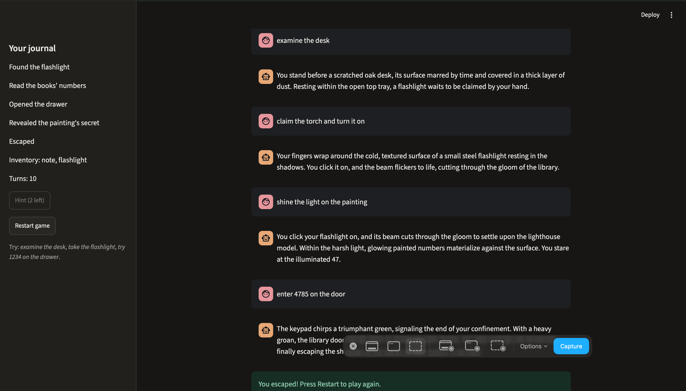

#  AI Escape Room (Gemini + Streamlit)

An LLM-powered text escape room. You wake up in a locked library and must find clues and a four-digit code to escape. The LLM acts as the **Game Master**. The project is built in two versions to show why pure-LLM games are unreliable and how to fix it.

| | Version 1 (`v1/`) | Version 2 (`v2/`) |
|---|---|---|
| Game state | Implicit, in chat history | Structured Python dict |
| Rules/solutions | In the LLM prompt | In Python, hidden from the LLM |
| Action validation | None | `engine.apply_action` |
| Win detection | LLM emits `[ESCAPED]` | Engine sets a flag |
| Cheating / jailbreaks | Not handled (out of scope) | Filtered; cannot change state |
| Tests | Manual | 14 automated tests |

## Problem
LLMs make great storytellers but poor rule keepers: they forget past actions, invent objects, leak solutions and can be talked into unlocking doors.

## Solution
V1 is the straightforward "LLM as everything" game. V2 moves state and rules into code; Gemini only (1) parses the player's intent and (2) narrates the outcome the engine computed. See [docs/architecture.md](docs/architecture.md) and [docs/AI-Escape-Room-Report.pdf](docs/AI-Escape-Room-Report.pdf).

## Tech stack
Python 3.10+, Streamlit, Google Gemini API (free tier, `google-genai`), python-dotenv, pytest.

## Installation
```bash
git clone https://github.com/<your-username>/AI-Escape-Room.git
cd AI-Escape-Room
python -m venv .venv && source .venv/bin/activate   # Windows: .venv\Scripts\activate
pip install -r requirements.txt
cp .env.example .env
```

## Run
```bash
streamlit run v1/app.py     # Version 1
streamlit run v2/app.py     # Version 2
pytest -q                   # V2 engine tests (no API key needed)
```

## How to play
Type natural-language actions: *examine the desk*, *take the flashlight*, *try 1234 on the drawer*, *use the flashlight on the painting*. Use **Restart** to start over. V2 also has a sidebar with progress, inventory and 3 limited hints.

## Development process
- **V1 problems:** state drift, invented objects, premature clue reveals, secrets in the prompt, LLM-declared victory.
- **V2 changes:** structured state, validation functions, inventory rules, hidden secrets, intent normalisation, narration guard, tests. Details: [docs/AI-Escape-Room-Report.pdf](docs/AI-Escape-Room-Report.pdf).

## Testing
Ten scenarios (including adversarial ones) in [docs/test-cases.md](docs/test-cases.md).


## Security
API keys are read from `.env` (git-ignored). Only `.env.example` is committed.

## Repository layout
```
v1/app.py        v2/{engine,llm,app}.py     tests/test_engine.py
docs/{architecture,test-cases}.md, AI-Escape-Room-Report.pdf
```

## Screenshots

### Version 1




### Version 2




