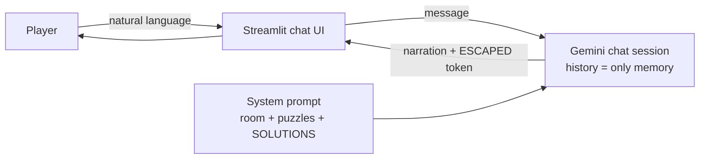
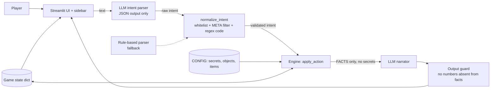

# Architecture

## Version 1 - LLM does everything

State, rules, secrets and win detection all live inside the LLM's context.

## Version 2 - Python decides, LLM describes

Key idea: secrets and state never enter an LLM prompt. The LLM sees the player's text (parser) and a short FACTS string (narrator).
